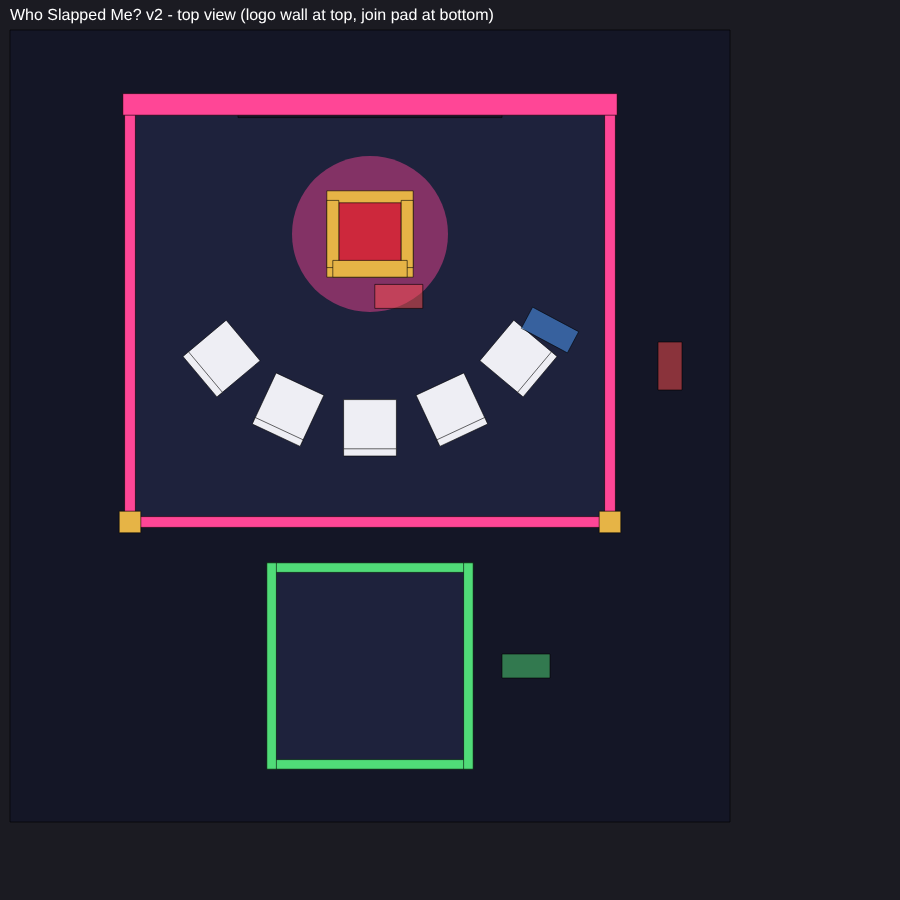

# 🖐️ Who Slapped Me?

A party game for 3-6 friends. One player sits in the **hot seat**, the players behind vote who slaps them,
the slapper charges the slap, the hot seat player tries to **block** it, and then has to **guess who did it**.
All rules and decisions are in [`NOTES.md`](NOTES.md).



**v2:** simpler and smaller (about 30 × 33 studs), no big screen, no bleachers, no spectate button.

---

## 📦 Files

| Path | What it is |
|------|------------|
| [`Release/WhoSlappedMe.rbxmx`](Release/WhoSlappedMe.rbxmx) | **The whole game in one file.** Insert this into Studio |
| [`Release/WhoSlappedMeUI.rbxmx`](Release/WhoSlappedMeUI.rbxmx) | Only the UI (the `WhoSlappedMeUI` ScreenGui). Right-click **StarterGui → Insert from File** to update just the UI |
| [`NOTES.md`](NOTES.md) | Requirements, decisions, ideas, open questions |
| `Docs/map_top.png` | Top view of the arena |
| `Original/` | The old prototype (kept for reference only) |

All scripts live **only inside the `.rbxmx`** (no copies elsewhere in the repo).

---

## 🛠 Install in Roblox Studio

1. In the Explorer, right-click **Workspace → Insert from File… → `WhoSlappedMe.rbxmx`**.
2. A folder **`WhoSlappedMe_INSTALL`** appears. Drag the content of each sub-folder into the service with the same name:

   | Inside `WhoSlappedMe_INSTALL` | Drag `WhoSlappedMe` into |
   |-------------------------------|--------------------------|
   | `ReplicatedStorage/WhoSlappedMe` | **ReplicatedStorage** |
   | `ServerScriptService/WhoSlappedMe` | **ServerScriptService** |
   | `StarterPlayerScripts/WhoSlappedMe` | **StarterPlayer → StarterPlayerScripts** |
   | `StarterGui/WhoSlappedMeUI` (the UI) | **StarterGui** |
   | `Workspace/WhoSlappedMe` (the arena model) | **Workspace** (move it anywhere you like) |

3. Delete the empty `WhoSlappedMe_INSTALL` folder.
4. Open **ReplicatedStorage → WhoSlappedMe → Config** and fill in your sound and animation IDs.

Result:

```
ReplicatedStorage
└── WhoSlappedMe
    ├── Config                 ⚙️ every setting
    └── Remotes/Net
ServerScriptService
└── WhoSlappedMe
    ├── Main                   server entry
    └── Modules
        ├── Game               lottery → vote → slap → guess, winners
        ├── Participants       players in the game: health, seats, locks, clean-up
        ├── JoinPad            join pad, countdown, sends out anyone stuck inside
        ├── Arena              finds map parts by name, pad sign
        ├── Seating · Anim · Net · Waiter
        ├── Reveal             🧪 test feature
        └── Titles             🧪 test feature
StarterPlayer > StarterPlayerScripts
└── WhoSlappedMe
    ├── ClientMain             client entry
    └── Modules
        ├── Picker             avatar cards (lottery, vote, guess)
        ├── PowerBar           slapper mini-game
        ├── Protect            black screen + BLOCK mini-game
        ├── CameraCtl · Fx · Hud · UI
        └── Rules              🧪 test feature
StarterGui
└── WhoSlappedMeUI (ScreenGui) the whole UI, real instances: edit it in Studio
Workspace
└── WhoSlappedMe (Model)       the arena
```

### 🎨 Editing the UI
The UI is a normal ScreenGui (`StarterGui → WhoSlappedMeUI`), built in the same style as the Park UI kit
(light see-through windows with dark text, 8px corners, drop shadow, light cards, solid green/red buttons, font `16658221428`, big auto-sized text).
Change colours, sizes, images and texts freely in Studio. **Only keep the names**, the scripts look them up:
`Status`, `PadInfo`, `Buttons/Leave`, `Buttons/Help`, `Banner`, `Picker` (`Head/Title`, `Head/Timer`, `Desc`, `TimerBar/Fill`,
`Content`, `CardTemplate`), `Power` (`Desc`, `Total`, `Bar/Needle`, `Bar/Yellow`, `Bar/Green`, `Chips/Chip1..3`, `Tap`),
`Blackout` (`Center/…`, `Flash`), `Rules` (`Head/Close`), `Winners` (`Row`, `WinnerTemplate`).

### Test it
**Test → Clients and Servers → 2 or 3 players → Start.** Walk everyone onto the glowing pad.
In Studio only, 2 players are enough (`STUDIO_TEST_PLAYERS`); a 2-player test plays until 1 is left. Live servers always need 3.
(Studio test players have no real avatar, so their pictures stay blank. In a live server they show.)

---

## ⚙️ Config (most used)

| Setting | Default | |
|---------|---------|---|
| `MIN_PLAYERS` / `MAX_PLAYERS` | 3 / 6 | |
| `JOIN_COUNTDOWN` | 15 | starts only when 3 players are on the pad, stops if someone steps off |
| `MAX_HEALTH`, `START_DAMAGE` | 100, 1 | everyone starts at 99 so Roblox shows its health bar |
| `MIN_SLAP_DAMAGE` / `MAX_SLAP_DAMAGE` | 5 / 40 | damage at 0% / 100% power |
| `CHARGE_VALUES` | 30, 30, 40 | max % each charge adds |
| `SWEEP_TIMES` | 1.3, 1.1, 0.9 | seconds per needle sweep (lower = harder) |
| `PERFECT_REDUCTION` / `GOOD_REDUCTION` | 0.7 / 0.4 | block damage reduction |
| `VOTE_TIME` / `GUESS_TIME` | 10 / 15 | |
| `SUDDEN_DEATH_ROUND` | 12 | damage +10% every round after this (max ×2) |
| `ANIMATIONS` | empty | `Sit`, `RaiseHand`, `Slap`, `Slapped` |
| `SOUNDS` | empty | `Slap`, `Whoosh`, `Heartbeat`, `Tick`, `Vote`, `Charge`, `Perfect`, `Block`, `Correct`, `Wrong`, `KnockOut`, `Win`, `Join` |

> ⚠️ Animations must be uploaded by the **same account or group that owns the game**, otherwise Roblox only plays them in Studio.
> Empty IDs are simply skipped, the game still works.

### 🧪 Test features (set to `false` to turn off)
| Setting | What it does |
|---------|--------------|
| `ENABLE_REVEAL` | after a wrong guess, everyone sees a replay of the slap and "It was X!" |
| `ENABLE_RULES_SCREEN` | "?" button that opens one panel with all rules (never opens by itself) |
| `ENABLE_TITLES` | "Mind Reader", "Iron Cheek", "Silent Slapper" above heads |

Each one is a separate module, so it can also be deleted later.

---

## 🗺️ Changing the map

Everything in `Workspace/WhoSlappedMe` is plain parts, so you can recolour, move or replace any of it.
The code only looks for these names:

| Name | What |
|------|------|
| `Seats/HotSeat` | Model (or Seat) with a **Seat** inside. Its front is where the hot seat player looks |
| `Seats/BackSeat1` … `BackSeat5` | Back seats. Fewer seats = fewer max players |
| `Points/SlapSpot` | Where the slapper stands (behind the hot seat, facing the same way) |
| `Points/KOSpot` | Where knocked-out players go |
| `Points/ExitSpot` | Where players go when they leave or the game ends |
| `Points/RevealCam` | Camera for the wrong-guess replay (the part's front = camera direction) |
| `Points/ArenaBounds` | Invisible box = inside of the arena. Anyone inside who is not playing is sent to `ExitSpot` |
| `JoinPad/Zone` | The area players stand on to join. Parts named `Glow` change colour |
| `JoinPad/Sign/Board` | Billboard with `Title`, `Count`, `Info` labels |

`Points` parts are visible in Studio and hidden automatically when the game runs.
